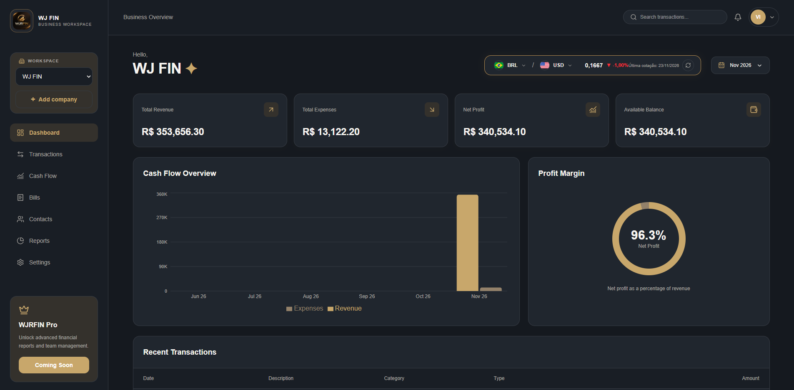
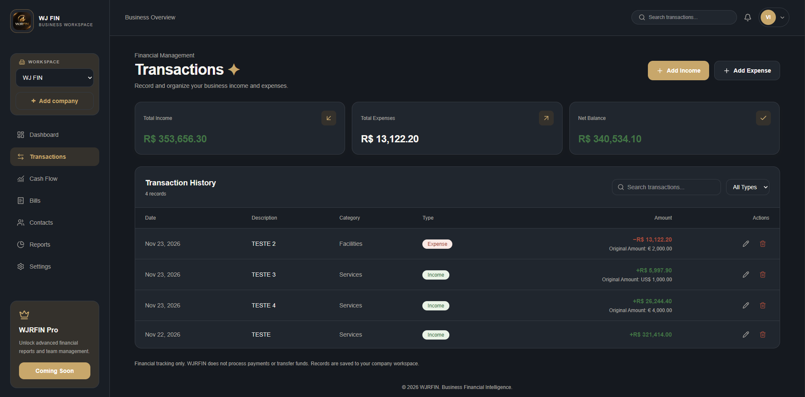
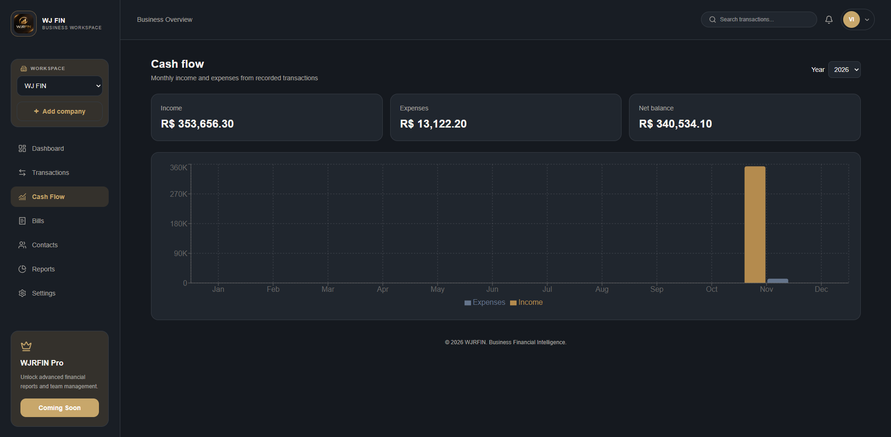

<div align="center">

# WJRFIN ✦

### Multi-Tenant Financial Management SaaS

**A modern financial workspace for managing business operations, tracking financial performance, and handling multi-currency transactions.**

Built with Next.js, React, TypeScript, Supabase and PostgreSQL.


**[Developer Portfolio](https://wilsonjrdev-portfolio.vercel.app/) · [GitHub Repository](https://github.com/wilsonjr-create/WJRFIN)**

</div>

---

## Overview

WJRFIN is a full-stack, multi-tenant financial management application designed to demonstrate modern SaaS architecture, secure data access, financial analytics, and external API integration.

The platform provides company-specific workspaces where users can organize financial transactions, monitor business performance, manage contacts, and analyze financial information through a premium dashboard.

The application supports multiple currencies and converts transaction amounts into each company's primary currency, while preserving original transaction values and exchange-rate information.

> **Portfolio project:** WJRFIN is a software engineering demonstration. It does not process payments, transfer funds, or provide banking services.

---

## Application Preview

### Financial Dashboard

A centralized overview of business financial performance, including revenue, expenses, net profit, available balance, cash flow visualization, and profit margin.



### Multi-Currency Transaction Management

Manage income and expenses, categorize financial records, and view transactions in the company's primary currency alongside their original amounts.



### Cash Flow Analytics

Explore financial activity through a dedicated cash flow interface designed to support business monitoring and financial visibility.



---

## Core Features

### Multi-Tenant Company Workspaces

- Company-specific financial workspaces
- Company membership and role-based authorization
- Data isolation through PostgreSQL Row Level Security
- Company-specific primary currency
- Company branding and workspace customization

### Financial Dashboard

- Revenue and expense indicators
- Net profit and available balance
- Cash flow charts
- Profit margin visualization
- Recent transaction activity
- Company-specific financial information

### Transaction Management

- Create, read, update, and delete financial transactions
- Income and expense categorization
- Search and filtering
- Original transaction amount and currency tracking
- Server-side currency conversion
- Historical exchange-rate preservation for unchanged transaction amounts

### Multi-Currency Support

Supported transaction currencies:

- BRL — Brazilian Real
- USD — United States Dollar
- EUR — Euro
- CNY — Chinese Yuan

Currency conversion integrates with the Frankfurter exchange-rate API.

Transactions retain original monetary values, converted values, exchange rates, and exchange-rate dates to improve historical consistency.

### Additional Workspace Modules

- Cash flow monitoring
- Financial reports
- Contact management
- Company settings
- Authentication and account management
- Multilingual interface support

---

## Technology Stack

| Layer | Technologies |
|---|---|
| Frontend | Next.js, React, TypeScript |
| Styling | Tailwind CSS |
| Backend | Next.js Route Handlers |
| Database | PostgreSQL |
| Backend Services | Supabase |
| Authentication | Supabase Auth |
| Authorization | Company memberships and Row Level Security |
| Currency Conversion | Frankfurter API |
| Deployment | Vercel-compatible Next.js application |
| Version Control | Git and GitHub |

---

## Architecture

WJRFIN follows a full-stack architecture using Next.js and Supabase.

```text
User Interface
    |
    v
Next.js / React
    |
    +---- Financial Dashboard
    +---- Transactions
    +---- Cash Flow & Reports
    +---- Contacts & Settings
    |
    v
Next.js Server Routes
    |
    +---- Authentication & Authorization
    +---- Transaction Validation
    +---- Currency Conversion
    |
    +---- Frankfurter Exchange Rate API
    |
    v
Supabase / PostgreSQL
    |
    +---- Companies & Memberships
    +---- Transactions
    +---- Company-Specific Records
    +---- Row Level Security
```

### Security and Data Isolation

The application uses Supabase authentication and PostgreSQL Row Level Security policies to support company-specific access control.

Server-side transaction operations validate the authenticated user, company membership, and permitted role before performing protected operations.

### Financial Data Consistency

Transaction amounts are converted on the server before persistence.

When a transaction is edited without changing its original amount or currency, the existing converted value and historical exchange-rate information are preserved.

Financial dashboard indicators are refreshed after transaction changes.

---

## Getting Started

### Requirements

- Node.js and npm
- A Supabase project
- Required database tables, permissions, and RLS policies
- Environment variables for Supabase

### Installation

Clone the repository:

```bash
git clone https://github.com/wilsonjr-create/WJRFIN.git
cd WJRFIN
```

Install dependencies:

```bash
npm install
```

Create a `.env.local` file and configure the required Supabase environment variables for your deployment.

**Never commit private credentials or service-role keys.**

Start the development server:

```bash
npm run dev
```

Open http://localhost:3000 in your browser.

> Database setup and Supabase configuration are required for authenticated financial features to work correctly.

---

## Design Philosophy

WJRFIN combines modern financial software functionality with a premium visual identity.

The interface emphasizes:

- Dark graphite surfaces
- Champagne-gold accents
- Clean typography
- Clear financial indicators
- Consistent navigation
- Readable data tables and analytics

The goal is to balance visual sophistication with practical business usability.

---

## Project Scope

WJRFIN was developed as a portfolio project to demonstrate:

- Full-stack application development
- SaaS architecture and multi-tenancy
- Authentication and authorization
- Relational database integration
- Secure server-side operations
- Financial data modeling
- Third-party API integration
- Responsive interface development
- TypeScript-based application architecture

**WJRFIN is not a commercial banking or payment-processing platform.**

---

## Developer

**Wilson Jr.**

Junior Software Engineer | Junior Full-Stack Developer

Bachelor's Degree in Software Engineering

[GitHub](https://github.com/wilsonjr-create) · [Portfolio](https://wilsonjrdev-portfolio.vercel.app/)

---

<div align="center">

**WJRFIN — Business Financial Intelligence**

Designed and developed by Wilson Jr.

</div>
